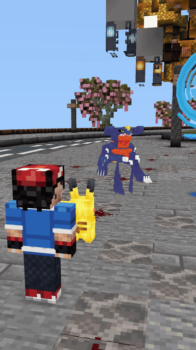
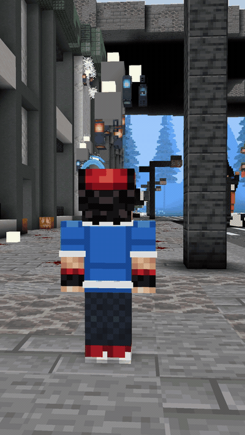
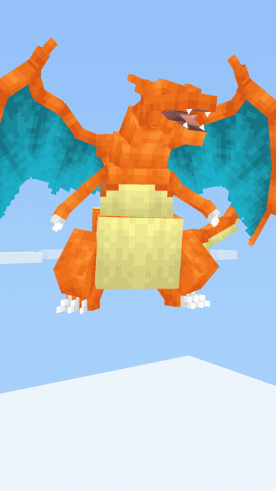
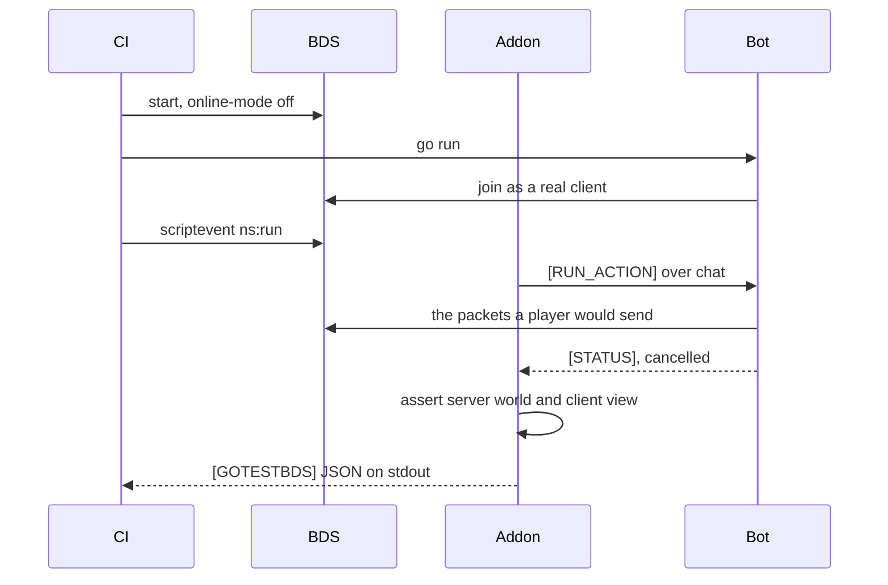
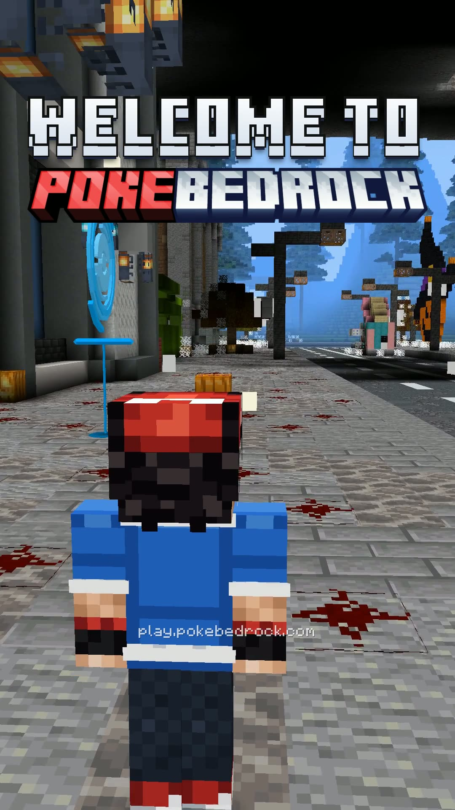

# go-test-bds

A headless Minecraft Bedrock client. It joins your server, plays it like a
player, and renders what that client sees. In a browser, or as a 60 fps
video, on a machine with no Minecraft installed.

<p align="center">
  
  
  
</p>

<p align="center">
  <sub>No Minecraft client. The bot joined a real server. This viewer drew the frames.</sub>
</p>

Built on [gophertunnel](https://github.com/Sandertv/gophertunnel). The bot is a
real network client, so a test hits the same packets, forms, and rejections a
phone does. The viewer turns that packet stream into a three.js world: blocks,
resource-pack models, animations, skins, and the server's JSON UI.

Two pieces ship together:

- **A Go binary** that connects one or more bots.
- **A TypeScript SDK** (`go-test-bds` on npm via GitHub) that your addon imports
  to write tests: a bot wrapper, a runner, assertions, and a JSON report for CI.

Models and textures in the clips above belong to the server that was recorded.
This repo does not ship them.

## How a test runs

The addon is the test runner. The bot is a player. Chat is the wire between
them, because chat is the only bidirectional channel the Script API has to a
client.

1. **Boot a server the bot is allowed to join.** `online-mode=false`, allowlist
   off. Dial BDS directly. The bot has no Xbox Live identity, so a proxy that
   demands a Microsoft login will refuse it.
2. **Start the bots.** One process, as many clients as you ask for. They show
   up as normal players, with a stable UUID across runs so persisted player
   data still matches.
3. **Start the suite from the addon.** A script event is the usual trigger, so
   CI can fire a run from the BDS console instead of editing the pack.
4. **The addon sends an instruction as chat**, prefixed `[RUN_ACTION]`. The bot
   performs it and answers with `[STATUS]`. The addon catches that in
   `beforeEvents.chatSend` and cancels it, so the traffic never reaches other
   players. Big replies (a form with dozens of buttons) split into
   `[STATUSPART]` chunks.
5. **Every instruction carries an id.** The response echoes it. Two bots can
   act at once without resolving each other's promises, and each instruction
   can time out on its own.
6. **Assert both sides.** The Script API is what the server believes.
   Observation instructions (`getState`, `getInventory`, `getForm`, `getBlock`,
   `getNearbyEntities`, `getMessages`) return what the _client_ was told. A
   desync the server cannot see is a failed test. That is the point.
7. **Clean up even when the test fails.** `ctx.track` runs in reverse on pass,
   fail, or timeout. Register the cleanup when you create the thing, or the
   first failure leaves entities behind and the next test fails for the wrong
   reason.
8. **Print a result CI can read.** One `[GOTESTBDS]` JSON line per event on
   stdout. A viewer, if one is attached, adds stills and a webm. Missing
   capture never fails a test.



An external program can drive the same bots without the addon in the loop.
`--control` (default `127.0.0.1:24781`) serves `GET /bots` and
`POST /bots/{name}/instruction`. Set `GOTESTBDS_CONTROL_TOKEN` if that port is
reachable past loopback. The header is the raw token, no `Bearer` prefix.

Use `--skin trainer.png` for a shared login skin and repeat
`--bot-skin TestBot2=opponent.png` to give an exact bot name its own PNG.
The equivalent config entry is `Skin.ByBot`; other bots keep `Skin.Path`.
Skins use the global `--skin-slim` arm model and are validated before connecting.

## Write a test

```typescript
import { assertEventually, defineSuite } from "go-test-bds";

export const shrineSuite = defineSuite({
  name: "Shrines",
  tests: [
    {
      name: "using the orb on a frozen shrine spawns its Pokémon",
      async run(ctx) {
        const shrine = { x: 2, y: 60, z: 0 };
        ctx.bot.player.dimension.setBlockType(shrine, "pack:custom_block");
        ctx.track(() =>
          ctx.bot.player.dimension.setBlockType(shrine, "minecraft:air"),
        );

        giveOrb(ctx.bot.player);
        await ctx.bot.interactWithBlock(shrine);

        await assertEventually(() => shrineHasSpawned(shrine), {
          timeoutMs: 10_000,
          description: "the shrine to spawn its Pokémon",
        });
      },
    },
  ],
});
```

Most addons talk through chained forms. Click by position and stop when the
server reaches a state you can observe, so a translation or a copy edit does
not break the test:

```typescript
await ctx.bot.clickThrough({
  until: () => getQuestStep(ctx.bot.player) === "accepted",
  description: "the quest to be accepted",
});
```

`bot.closeForm()` dismisses whatever is open (action, modal, or custom).

## Run it

Start the bot against BDS, not against a proxy:

```bash
go run . --address 127.0.0.1:19134 --name "Test Bot" --bots 1
```

Flags win, then environment (`GOTESTBDS_ADDRESS`, `GOTESTBDS_BOT_NAME`,
`GOTESTBDS_BOTS`, `GOTESTBDS_LOG_LEVEL`), then `config.toml`.

Item clicks use `auth-input` by default for BDS. For servers that accept air/block
clicks only through the legacy inventory handler (for example Dragonfly 0.11.6),
set `--item-interaction-transport inventory-transaction`. The equivalent environment
variable is `GOTESTBDS_ITEM_INTERACTION_TRANSPORT`; the TOML key is
`ItemInteractionTransport` under `[Network]`. The Go API exposes
`Test.ItemInteractionTransport` and `Actor.SetItemInteractionTransport` with the
`actor.ItemInteractionAuthInput` / `actor.ItemInteractionInventoryTransaction`
constants. This is an explicit per-session setting: server addresses, resource
packs, and authoritative-inventory flags do not select it automatically. Both
modes send each click once and preserve queued action order. Entity interactions
and item releases retain their standalone inventory-transaction encoding.

Install the SDK in the addon:

```bash
npm i github:smell-of-curry/go-test-bds
```

Wait for the join, then run the suite:

```typescript
import { Bot, runSuites } from "go-test-bds";

const bot = await Bot.waitForJoin("Test Bot", { timeoutMs: 60_000 });
const result = await runSuites([shrineSuite], { bots: [bot] });
```

Fire that from a script event:

```
scriptevent yourns:run {"runId":"ci-123"}
```

### What you can ask the bot to do

| Act                                                            | Observe                                    |
| -------------------------------------------------------------- | ------------------------------------------ |
| Chat, run a command, jump, sneak, hold movement                | Position, dimension, rotation (`getState`) |
| Path to a block, look at a block, entity, or point             | The block the client has (`getBlock`)      |
| Break, place, interact with a block or entity, attack          | Nearby entities                            |
| Open inventory transactions, change the held slot              | Inventory, including a forced resync       |
| Wait for a form, click by text or index, walk a chain, dismiss | The open form, recent chat                 |

Anything the wrapper does not cover yet is still reachable with `runAction` /
`runActionForData`. Instruction parameter types are generated from the Go
structs (`npm run generate:types`), so the two sides cannot drift.

## What the client is actually told

An observation is only as good as what BDS pushes.

- **Blocks** arrive. With `block-network-ids-are-hashes` (the BDS default) a
  chunk palette holds hashes, and chunks arrive through sub-chunk requests. The
  bot handles both, plus `UpdateSubChunkBlocks` for edits the server makes
  itself.
- **Inventory does not.** A Script API write (`Container.setItem`, `addItem`,
  `swapItems`, `EntityEquippable.setEquipment`) leaves the client's copy stale,
  and no client action forces a refresh. Only a real inventory transaction,
  such as `/give` or `/replaceitem`, resyncs the window, and it resyncs all of
  it. `Bot.getInventory` forces one server-side (a marker item, added and
  cleared) before reading. Pass `{ sync: false }` to read the stale copy on
  purpose. That is how you assert what the client has _not_ been told.

## Watch a run

`--viewer` opens an HTTP hub (default `127.0.0.1:24680`) that streams world
snapshots and, with `--viewer-app`, serves the three.js app:

```
http://127.0.0.1:24680/?bot=Test%20Bot
```

`C` cycles first-person, follow, and orbit. From a test:

```typescript
await ctx.screenshot("after-the-shrine-lights-up");
```

That returns null when nobody is rendering. The same test runs in CI with or
without a viewer. Stills and one `run.webm` show up as artefacts on `testEnd`
and `runEnd`.

Pack-specific HUD, title tokens, and form routing live in an extension
directory (`--viewer-extensions`). The viewer paints the server's JSON UI
without per-pack code. The extension API is in
[viewer/README.md](viewer/README.md#viewer-extensions).

## Render a short

Record a take while the bot plays, then render it later. Film mode does not
open a live stream. It replays the recording on a virtual clock, one output
frame at a time, so motion, animation, particles, and the sky all read virtual
time. The default camera is the actor. A camera track replaces it after the
fact, so you can re-shoot the camera without playing the scene again. Software
GL is enough (`--gpu` defaults to SwiftShader).

Build the viewer once (`cd viewer && npm install && npm run build`). Record
from the repo root while the bot plays:

```bash
go run . --viewer --viewer-app ./viewer/dist --record ./take \
  --address 127.0.0.1:19134 --name "Test Bot"
```

Render that take afterwards, from `viewer/`:

```bash
npm run film -- render \
  --take ../take --bot "Test Bot" \
  --from 0 --to 8 \
  --width 1080 --height 1920 --fps 60 \
  --out ./clip.mp4
```

Odd sizes are padded by one pixel for the encoder. Diagnostic HUD, name tags,
and view bobbing stay off unless you ask for them. Details are in
[viewer/README.md](viewer/README.md#film-mode).

This is enough to film a server that has no real client in the loop. Bots
stage the scene and record the take. The viewer renders every frame. A separate
editor can lay titles, music, and a generated voice on top. That editor is not
this repo. The picture is.

<p align="center">
  
</p>

<p align="center">
  <sub>A promo short cut from a take like the clips above. Footage from this viewer. Type and voice from elsewhere.</sub>
</p>

## Report to CI

`StructuredReporter` writes one JSON object per event, prefixed `[GOTESTBDS]`:

```
[GOTESTBDS]{"kind":"testEnd","suite":"Shrines","name":"...","status":"passed","durationMs":812}
[GOTESTBDS]{"kind":"runEnd","runId":"ci-123","totals":{"total":1,"passed":1,"failed":0,"skipped":0}}
```

Whatever supervises BDS tails stdout and decides the build. No log scraping.

| Module        | Role                                                                                     |
| ------------- | ---------------------------------------------------------------------------------------- |
| `bot.ts`      | Actions and observations                                                                 |
| `runner.ts`   | Suites, timeouts, tag filters, hooks, `ctx.track`, `ctx.screenshot`                      |
| `assert.ts`   | `assertNearPosition`, `assertBlockAt`, `assertEventually`, and the usual equality checks |
| `wait.ts`     | `waitFor`, `waitForValue`, `retry`, `sleep`. Timeouts name what they were waiting for    |
| `reporter.ts` | `ConsoleReporter` for humans, `StructuredReporter` for CI                                |
| `protocol.ts` | The chat envelope, if you are building your own client                                   |

You should not build that envelope by hand. Use `Bot`.

## License

[ISC](https://www.isc.org/licenses/).

## Compare with a real client

The optional shadow proxy forwards a real Bedrock client's packets to a local
BDS and mirrors its state into the viewer. The real client owns movement; the
viewer actor stays passive. This is a development listener without Xbox
authentication, intended for a trusted local test server.

```sh
go run . --address 127.0.0.1:19132 --shadow-listen 127.0.0.1:19133 \
  --viewer --viewer-address 127.0.0.1:19140 --viewer-app viewer/dist
```

Connect Minecraft to port 19133. Resource packs are downloaded during the
initial probe; repeat `--shadow-pack /path/to/pack` to use local pack archives or
directories instead. Environment equivalents are `GOTESTBDS_SHADOW_LISTEN` and
`GOTESTBDS_SHADOW_PACKS` (comma-separated paths).

For pixel-font UI rendering, set `GOTESTBDS_VIEWER_FONT_DIR` to a directory
containing `Mojangles.ttf`, `default8.png`, and `default8.json` (when present)
from your installed client before starting the viewer
host. No Minecraft font is bundled. Without it, labels use the system fallback.
The same variable enables the optional font raster tests in `viewer/`.

Recovered real-client observations and outstanding comparison work are in
[viewer/FINDINGS-jsonui.md](viewer/FINDINGS-jsonui.md). Automated regression
checks do not establish complete visual parity with every Bedrock screen.
